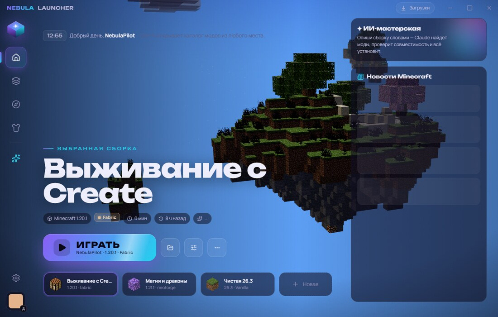
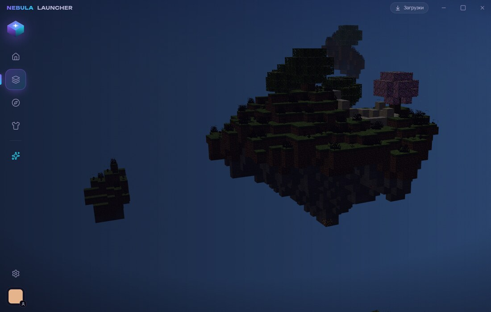
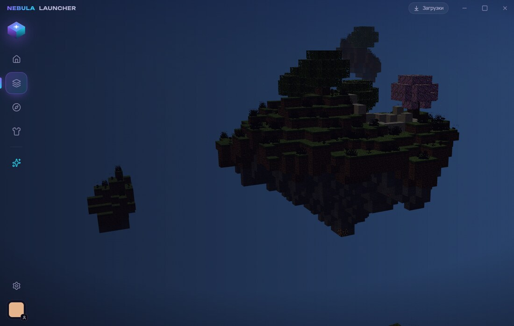
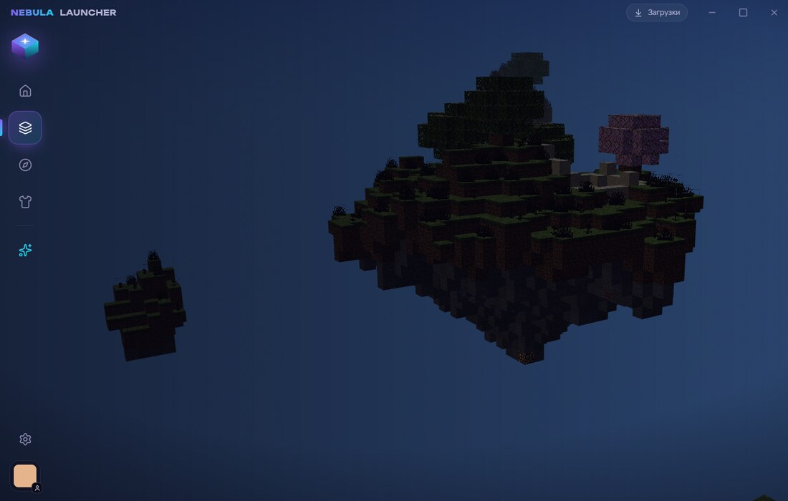
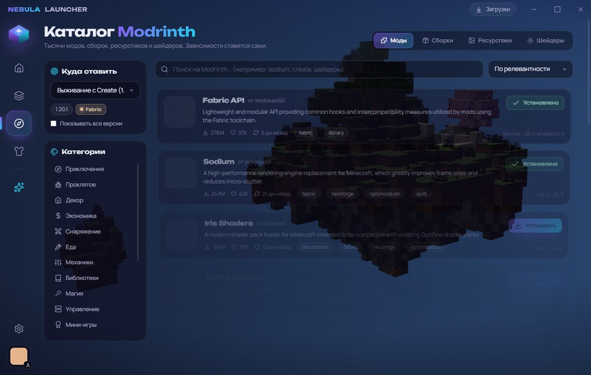
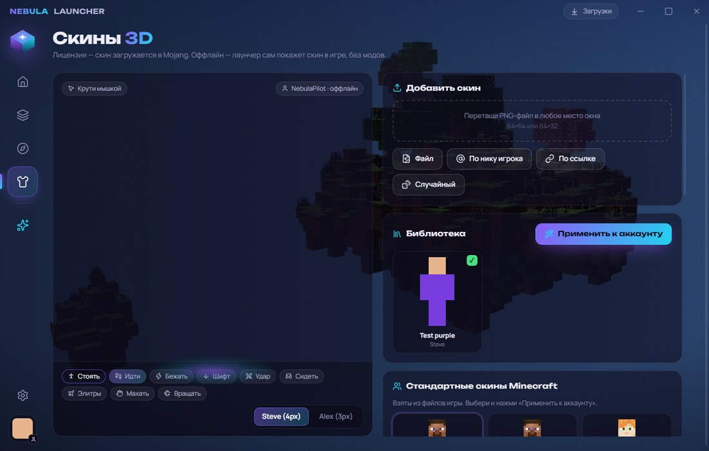

# Nebula Launcher

Лаунчер Minecraft: сборки как в Prism, моды с Modrinth, 3D-скины и ИИ-мастерская,
в которой Claude или Codex собирают сборку по одной фразе.



## Скачать

Последняя версия лежит в [Releases](https://github.com/KotikVanil/nebula-launcher/releases/latest).
Скачай и запусти `Nebula Launcher Setup x.y.z.exe`. Дальше лаунчер обновляется сам: в шапке появляется кнопка «Обновление».

## Возможности

- **Два способа входа:** Microsoft (лицензия) и оффлайн по нику. Аккаунтов сколько угодно, токены шифруются.
- **Сборки (инстансы):** у каждой своя `.minecraft`. Загрузчики Vanilla, Fabric, Quilt, Forge и NeoForge. Сборку можно дублировать, разложить по группам, экспортировать и импортировать в `.mrpack`.
- **Java ставится сама:** официальные сборки Mojang под каждую версию игры.
- **Каталог Modrinth:** моды, модпаки, ресурспаки и шейдеры. Фильтр под выбранную сборку, зависимости ставятся сами, есть проверка обновлений модов.
- **Наборы в один клик:** оптимизация, шейдеры, удобства, карты, атмосфера, приключения, техника, магия.
- **Проверка сборки:** находит недостающие зависимости, моды не под тот загрузчик, дубликаты и конфликты (с учётом версий). Кнопка «Починить» докачивает недостающее.
- **Скины в 3D:**
  - Анимации повторяют игровые: ходьба, бег, шифт, удар, сидение. В покое голова следит за курсором.
  - Есть стандартные скины Mojang и генератор случайных.
  - Добавить скин можно перетаскиванием файла, по нику игрока или по ссылке.
  - Лицензия: скин загружается в Mojang, плащи переключаются в лаунчере.
  - Оффлайн: скин виден в одиночной игре и по LAN без модов (через authlib-injector).
- **Настоящий вид Minecraft:** текстуры блоков и стандартные скины берутся из клиента игры на твоём компьютере. Ресурсы Mojang в лаунчер не встроены.
- **Разбор вылетов:** причина простыми словами и кнопка «Починить с ИИ».
- **ИИ-мастерская:** встроенный чат с Claude. Подключение Claude Code и Codex в один клик через MCP (26 инструментов). Подробности в [docs/AI_GUIDE.md](docs/AI_GUIDE.md).

| | |
|---|---|
|  |  |
|  |  |
|  |  |

## Сборка из исходников

```bash
npm install
npm start            # запуск
npm run dist         # установщик в dist/
```

- MCP-сервер: `mcp/server.mjs`.
- CLI: `node cli/nebula.js`.
- Данные лаунчера: `%APPDATA%\.nebula-launcher`.

## Лицензия

MIT. Minecraft — товарный знак Mojang AB. Проект не связан с Mojang и Microsoft.
